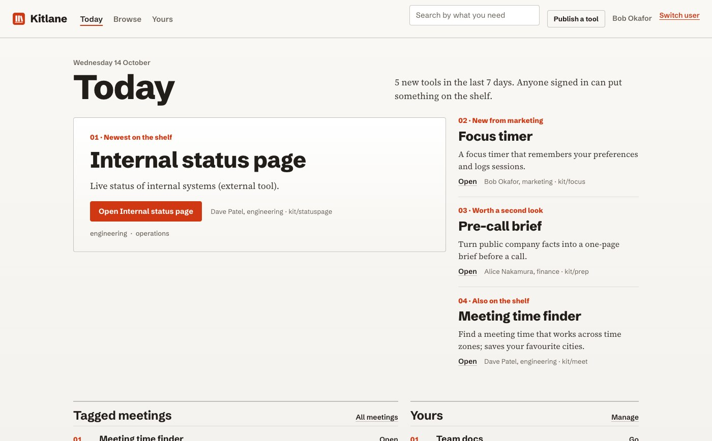

# Kitlane

An internal front door for the software people make.

Give an employee-made tool a memorable address, and let using that tool reveal what else colleagues have made. Kitlane publishes static tools (or registers existing URLs) under short names such as `kit/prep`, launches hosted tools inside a shell with a persistent **Explore tools** rail, and lets anyone remix a published tool and adapt it with whatever builder they prefer, with the original maker credited. Hosted tools get identity, durable per-user storage, and company-readable shared collections through a small browser SDK.

The rail is the primary discovery mechanism. A portal with search and browsing exists for deeper exploration, but success does not depend on people remembering to visit a directory. Builder neutrality is central: a tool can come from an agent, a visual builder, or ordinary development, and AI use is never an eligibility requirement.

**Status: early reference implementation, v0.2 in progress.** This repository implements Kitlane v0.2; the architecture and scope are described in [docs/architecture.md](docs/architecture.md) and [docs/roadmap.md](docs/roadmap.md). It is suitable for a local demonstration and for a cautious team pilot by an operator who reads the installation and security documents first. It is not yet a validated enterprise deployment. See [RELEASE-NOTES.md](RELEASE-NOTES.md) for exactly what is implemented, verified, untested, and deferred.

## What is implemented

| Area | State |
|---|---|
| URL registration, stable IDs, memorable names with history, reserved names | Implemented, tested |
| CLI publishing of a single HTML file or a folder; immutable versions; rollback | Implemented, tested |
| Owner, co-maintainer, and administrator authorization; freeze; content removal with audit | Implemented, tested |
| Shell with the Explore tools rail and drawer; explainable recommendations; the rail matches the tool's theme | Implemented, checked manually in Chrome |
| Portal: Today page with rule-based picks and an administrator override, search, filters, tool pages, lineage, name history, preferences, admin | Implemented |
| Visual system: self-hosted type, light and dark themes, one stylesheet | Implemented, checked manually in Chrome at desktop and phone widths |
| Remix with lineage (the original maker stays credited); download published files; `kitlane pull` | Implemented, tested |
| Publishing from a git repository: `kitlane init --workflow` (GitHub Actions), the CLI served by each installation, remix by fork with lineage recorded on first publish | Implemented, tested |
| Identity SDK, personal documents, shared collections, writer grants, updater credentials | Implemented, tested |
| Discovery measurement with a north-star report | Implemented, tested |
| Catalog export; operator backup and restore scripts | Implemented; scripts run once against the local stack |
| `kitlane init` with bounded agent guidance | Implemented, tested |
| Publishing allowlist and banner for public demonstration installations | Implemented, tested |
| Docker Compose package with oauth2-proxy, Caddy, Postgres, optional Keycloak | Local profile verified 2026-10-07 (curl and Chrome) including backup and restore; team profile deployed and verified on a public server with Google sign-in 2026-10-13 |
| Optional AI gateway (`kitlane.ai.chat`) | Deferred; design in [docs/deferred/ai-adapter.md](docs/deferred/ai-adapter.md) |

## Quick start

### Try locally without Docker

Requires Node 22 or newer. Uses an embedded Postgres (PGlite) and a clearly labelled development identity.

```sh
npm install
npm run build
npm run seed
npm run dev
```

Open <http://kit.localhost:3000/.dev/login>, pick a synthetic user, then open `kit/prep` at <http://kit.localhost:3000/prep>. Chrome, Firefox, and curl resolve `*.localhost` to this machine without configuration. Details and troubleshooting: [docs/install-try-locally.md](docs/install-try-locally.md).

### Try locally with Docker Compose and a real sign-in

Adds Keycloak as a test identity provider behind oauth2-proxy, with HTTPS from a local certificate authority and separate portal and tool origins.

```sh
cd deploy/compose
./scripts/setup.sh
docker compose -f docker-compose.yml -f compose.local.yml up -d --build
./scripts/trust-local-ca.sh
docker compose -f docker-compose.yml -f compose.local.yml run --rm kitlane seed   # optional demo data
```

Then open <https://kit.localhost> and sign in as `alice` / `password`. This path was run on 2026-10-07: Keycloak sign-in through oauth2-proxy, the portal session, a CLI publish over HTTPS, and the per-origin tool sign-in were verified with curl against the running stack. See the remaining caveats in [docs/install-try-locally.md](docs/install-try-locally.md).

### Run for a team

One server, Docker, a domain with records for `kit.<domain>` and `*.sites.kit.<domain>`, and an OIDC client at your identity provider. Follow [docs/install-run-for-a-team.md](docs/install-run-for-a-team.md).

## Screenshots

Development build with synthetic data. The Today page, where the picks are chosen by rules an administrator can override:



The shell for `kit/prep` with the Explore tools handle on the right. The rail matches the tool's theme, here light:


The drawer open on a dark tool: "This tool", then "Also on the shelf" with the reason each row appears:


## Repository layout

```
packages/server          Control service: catalog, names, publishing, shell, SDK routes, document storage
packages/sdk             Browser SDK served on every tool origin at /._kitlane/sdk.js
packages/cli             The `kitlane` command-line tool
examples/                Seed tools and synthetic data (prep, briefs-editor, focus, meet, updater)
deploy/compose           Docker Compose reference installation (local demo and team profiles)
site/                    Static landing page and demo privacy notice (host separately)
docs/                    Architecture, installation, security, SDK, CLI, measurement, roadmap
Dockerfile               Image for the control service
```

## Documentation

- [Architecture](docs/architecture.md)
- [Install: try locally](docs/install-try-locally.md)
- [Install: run for a team](docs/install-run-for-a-team.md)
- [Install: a public demonstration with Google sign-in](docs/install-public-demo.md)
- [Security baseline](docs/security-baseline.md)
- [Backup and restore](docs/backup-restore.md)
- [Hosting constraints for tool authors](docs/hosting-constraints.md)
- [SDK reference](docs/sdk.md)
- [CLI reference](docs/cli.md)
- [Adaptation: copy, pull, publish](docs/adaptation.md)
- [Discovery measurement](docs/measurement.md)
- [Deferred: AI adapter design](docs/deferred/ai-adapter.md)
- [Roadmap](docs/roadmap.md)
- [Release notes](RELEASE-NOTES.md), [Security policy](SECURITY.md), [Contributing](CONTRIBUTING.md)

## License

Apache License 2.0. See [LICENSE](LICENSE) and [NOTICE](NOTICE). The platform license does not license an installation's hosted tools or data, and it grants no trademark rights.
